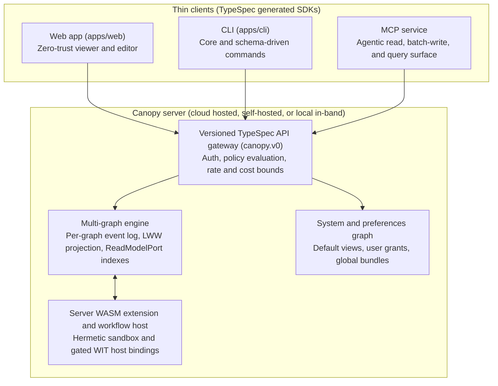
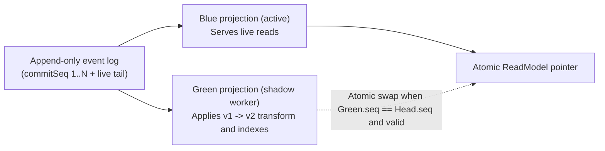

# Canopy v0 architecture and product breakdown

This document defines the target product, domain model, consistency guarantees, extension runtime, and TypeSpec API architecture for the `canopy.v0` reshape.
It supersedes legacy multi-protocol assumptions (`Connect`, `GraphQL`, bespoke Unix-socket `IPC`), speculative `ApprovalState` and `expectedSequence` fields, and `openspec/` design artifacts.
See [Core tenets](core-tenets.md) for overarching product intent and [Core data model and type system](../design/2026-02-06-core-data-model.md) for the initial kernel foundation.

## Product topology and deployment modes

Canopy is an open-source, server-first graph knowledge database and application platform (`canopy-server` / `app-server` backplane) paired with thin clients generated from a single TypeSpec contract.

### Deployment modes

All deployments share the same server engine and `canopy.v0` API boundary:

1. **Hosted public playground**: A wiki-style sandbox instance where users create and explore graphs in the browser with no durability guarantees.
2. **Self-hosted or local in-band server**: A single server process for personal, developer, or team use (or an in-browser Web Worker host behind the same TypeSpec client interface when running zero-install demos).
3. **Managed cloud tiers**: Paid hosted multi-graph deployments with durable storage, backups, and high-throughput quotas.

### Commercial and open-source extension boundary

The core engine, TypeSpec API contracts, thin clients, and open-source bundles remain open source.
Hosted cloud capacity and optional commercial WASM plugin bundles (gated by activation keys) sit cleanly on top of the graph-resident `Plugin` and `Bundle` contracts.

### Thin client build order

Client surfaces roll out in strict priority order against the `canopy.v0` server API:

1. **`apps/web`**: Primary user experience proving the core capture, schema, query, view, and zero-trust foreign-graph viewing loops.
2. **`apps/cli`**: Scriptable terminal client supporting core graph commands plus dynamic schema-driven commands (for example, `canopy node Person create`).
3. **Basic MCP service**: Thin agentic protocol surface over the same API so AI agents can drive and test the system end-to-end.

### Shared graphs as websites (zero-trust viewing)

Visiting a shared graph works like visiting a website with progressive capability prompts:

- **Default zero-trust mode**: Any readable graph renders immediately using built-in/system-graph default views over `Node`, `Edge`, and `Property` primitives, executing zero untrusted code.
- **Hermetic WASM views**: Graph-embedded `View` and `Plugin` WASM components run inside a pure, zero-I/O sandbox to render custom layouts, queries, and entry forms.
- **Permission prompts for non-hermetic access**: If a graph's plugin requests filesystem, external HTTP, secret handles, or cross-graph writes, the host surfaces a browser-style permission prompt before enabling that WIT binding.

## Core domain model and primitives

### Vocabulary baseline (`canopy.v0`)

Canopy uses `canopy.v0` as its versioned API and domain namespace baseline:

| Term       | Role in `canopy.v0`                                                                                       | Revisitable UI/product metaphors |
| :--------- | :-------------------------------------------------------------------------------------------------------- | :------------------------------- |
| **Canopy** | Multi-graph server, workspace, or system root                                                             | Forest / Universe                |
| **Graph**  | Self-contained unit of event storage, convergence, per-graph schema migration, and full-graph time travel | Grove / Tree / Space / Galaxy    |
| **Node**   | Immutable property-bearing entity with UUIDv7 `id`                                                        | Object                           |
| **Edge**   | Immutable directed, property-bearing relationship between two local `NodeId`s in the same graph           | Link / Relation                  |

Container metaphors (`Forest`/`Grove`/`Branch` or outer-space `Universe`/`Galaxy`/`Constellation`) remain documented as optional UI presentation choices once the core loop ships.

### Three structural primitives only

The kernel defines exactly three structural primitives: **`Graph`**, **`Node`**, and **`Edge`**.
There is no fourth `Molecule` or `Cluster` primitive in storage or event logs:

- **Explicit subgraphs (such as Beads `bd mol`)**: A `Molecule` is a `Node` connected to its member nodes by typed `Edge`s (`contains`, `step_of`).
- **Dynamic clusters ("superset galaxies")**: Subgraphs such as a raw node plus all shaped nodes derived from it are computed by `Query` definitions and rendered by `View` plugins.

Every `Edge` connects two local `NodeId`s within the same `Graph`.
External URLs (`https://...`), unfinalized concepts, and cross-graph references (`canopy://...`) are represented as local proxy `Node`s in the graph so backlinks, annotations, offline replay, and time travel remain pure functions of that graph's event log.

### Open versus shaped elements (`0 or 1 Shape` invariant)

Every `Node` and `Edge` carries at most one `Shape` (`shape: Option<ShapeId>`):

- **Open (`shape = none`)**: Accepts free-form `PropertyMap` entries for zero-friction capture and raw ingestion.
- **Shaped (`shape = Some(ShapeId)`)**: Binds to a single `Shape` node. A `Shape` declares required and optional properties (inline or referencing reusable `PropertyType` nodes) and a `closed: boolean` flag controlling whether undeclared extra properties are permitted or rejected.
- **No multi-shape stacking**: Limiting each entity to `0 or 1` `Shape` eliminates diamond inheritance conflicts and guarantees deterministic view dispatch. Cross-cutting labels and reusable traits use `PropertyType` fields (such as `Set<Label>`) or composition when authoring `Shape` definitions.

### System node types inside the graph

Definitions and system configuration live inside the graph as nodes alongside user content:

- **Schema and linked data**: `Namespace`, `Shape` (for nodes and edges), and `PropertyType` (reusable scalars and collections such as `Timestamp`, `NonNegativeInt`, `URL`, `Enum`, `Set<Label>`, `Ref<Shape>`, with optional `schema.org` URIs and `one` | `many` cardinality).
- **`Query`**: Standalone data-selection specification (filters, traversals, joins, parameter bindings, and history cuts).
- **`View`**: Standalone dimensional presentation or interactive surface.
- **`Plugin`**: Graph node referencing a content-addressed WASM component (`sha256:...`), requested WIT capability manifest, and optional commercial activation metadata.
- **`Workflow` and `Migration`**: Triggered automation definitions and per-graph schema/data migration registrations.
- **`Setting` and `Bundle`**: Configuration nodes and installable subgraphs packaging schemas, queries, views, migrations, and WASM plugins.

### `Query` and `View` separation and `RenderSelector` edges

`Query` and `View` are distinct, independent node types.
A `View` **does not require a `Query`**; its binding target is determined recursively by **`RenderSelector` edges** (carrying `context`, `priority`, and `isDefault` properties):

- **Standalone `View`**: Unbound interactive tools such as an AI chat surface, scratchpad, or timer.
- **`Shape`-bound or open-node `View`**: Data-entry creation forms or raw-note inspectors paired with an AI classifier sidecar.
- **Entity-bound `View`**: Node or edge detail inspectors.
- **Query-bound `View`**: Tables, Kanban boards, spatial graphs, or duplicate/conflict review views over a `Query` result set.

Recursive in-graph resolution enforces three invariants:

1. **Base-case termination**: Recursion terminates at host-known leaf primitives (`text`, `number`, `date-input`, `layout-stack`) or a WASM `Plugin` renderer.
2. **Visited-set cycle guard**: Resolution tracks `(visitedNodeIds, visitedViewIds, depth <= maxDepth)` and renders a cycle warning if a `RenderSelector` path loops.
3. **$O(1)$ index caching**: `ReadModelPort` pre-indexes schema-level `(targetShapeOrPropertyType, context) -> viewNodeId` mappings so rendering large lists or tables avoids $N+1$ graph queries.

## Canonical user and agent journeys

| #     | Journey                                      | Core workflow                                                                                                                                                                                                                                                                       | Required API / kernel capability                                                          |
| :---- | :------------------------------------------- | :---------------------------------------------------------------------------------------------------------------------------------------------------------------------------------------------------------------------------------------------------------------------------------- | :---------------------------------------------------------------------------------------- |
| **1** | **Atomic multi-entity capture**              | A user or agent creates multiple open/shaped nodes and edges together in one save action.                                                                                                                                                                                           | Single atomic batch commit (`batchId`) spanning multiple nodes and edges.                 |
| **2** | **Immutable raw capture to derived lineage** | Raw notes/clips land as open nodes; humans, AI models, or workflows emit new strongly typed nodes (`contacts:Person`, `tasks:Task`, `schema.org/*`) linked back via `derived_from` / `supersedes` edges instead of mutating raw source nodes in place.                              | Multi-node + provenance-edge batch commit; immutable source preservation.                 |
| **3** | **External URLs via local proxy nodes**      | Linking to `https://en.wikipedia.org/...` or an uncreated entity creates a local proxy `Node` and `Edge` in one batch; a server plugin asynchronously enriches its properties via `NodePropertiesUpdated`.                                                                          | Proxy `Node` index lookup by canonical `uri`; background plugin write path.               |
| **4** | **Converge-first conflict resolution**       | Concurrent offline writes never block on semantic duplicates; events converge deterministically and `Query` + `View` plugins surface duplicates and `nodes-since` diffs for review/merge.                                                                                           | Deterministic LWW projection; `Query` predicates over duplicate keys and sequence ranges. |
| **5** | **Full Beads (`bd` + superset) bundle**      | Issue types (`task`, `bug`, `epic`, `decision`), dependency edges (`blocks`, `parent`, `discovered_from`, `supersedes`), `bd ready` transitive blocked queries, `formula` $\rightarrow$ `molecule` instantiation, `--claim` CAS, and Kanban/dependency views run as a graph bundle. | Transitive graph queries; `Entity CAS` preconditions; installable `Bundle` subgraphs.     |

## Consistency, ordering, and migration model

### Dual event ordering and actor provenance

Every committed event records:

- **`hlcTimestamp` (Hybrid Logical Clock)**: Captures causal client ordering (`max(physical, lastSeen) + counter + actorId`) across distributed clients without wall-clock skew anomalies.
- **`commitSeq` (`uint64` per-graph sequence)**: Assigned monotonically by the server upon log append, establishing a strict total serialization order for that graph.
- **Provenance**: `principalId`, `actorId` (`user` | `agent` | `plugin` | `workflow`), and `deviceId`. Speculative `ApprovalState` and `properties.tenantId` fields are removed.

### Write consistency modes (per transaction batch)

| Mode                     | Precondition                                       | Semantics                                                                                                                                     | Primary use cases                                                       |
| :----------------------- | :------------------------------------------------- | :-------------------------------------------------------------------------------------------------------------------------------------------- | :---------------------------------------------------------------------- |
| **Unconditional append** | None                                               | Appends with zero lock contention; concurrent property races converge deterministically via `hlcTimestamp` LWW (losers preserved in history). | High-throughput parallel agent ingest, capture, observations.           |
| **Entity CAS**           | `expectedEntitySeq: Map<NodeId \| EdgeId, uint64>` | Rejects with `CONCURRENCY_CONFLICT` if any listed entity changed since `expectedEntitySeq`; unrelated entities commit in parallel.            | `bd update --claim`, state transitions, interactive node edits.         |
| **Graph CAS**            | `expectedGraphSeq: uint64`                         | Rejects if any event landed in the graph since `expectedGraphSeq`.                                                                            | Whole-graph operations (bulk refactors, exclusive structural rewrites). |

### Read consistency modes (session `minCommitSeq`)

Every write commit returns the resulting `commitSeq: uint64`.
Read requests accept an optional `minCommitSeq: uint64`:

1. **Read-your-writes + monotonic reads (Default)**: If `projection.appliedSeq >= minCommitSeq`, reads execute immediately from `ReadModelPort` indexes with zero wait; otherwise the read awaits catch-up to `minCommitSeq`.
2. **Point-in-time snapshot (`atCommitSeq` or `atTimestamp`)**: Reads an immutable historical state (`getGraphAt`) without blocking live writers.
3. **Linearizable read**: Synchronizes with the write log's current `headCommitSeq` before executing.

### Online `v1 -> v2` migrations and whole-graph operations

Rewriting thousands of nodes synchronously on the write path stalls concurrent traffic and bloats the event log.
Schema migrations instead use **Expand-Contract + Blue-Green shadow projection**:

1. **Register migration**: Commit a single `ShapeMigrationRegistered(v1 -> v2, transformWasmRef)` event instead of $N$ node mutation events.
2. **Build `Green` shadow projection**: A background worker projects existing state through the `v1 -> v2` transform and tails live events (`> N`) while `Blue` serves live traffic uninterrupted.
3. **Validate and swap**: If validation fails in `Green`, the migration aborts cleanly without touching `Blue`. Once `Green` catches up and validates, the server swaps the active read-model pointer atomically in $O(1)$.

Whole-graph operations (such as full-graph snapshots, rewrites, or multi-shape migrations) introduce cross-entity locking, projection memory duplication, and rollback invariants that require dedicated design validation during Track C.

## Extension runtime, WIT boundaries, and access policy

### Server-first runtime vs. client extensions

- **Server-side extensions (default)**: Transformations, AI classifiers/predictors, Temporal-style workflow automations, external URL enrichment, and custom query/view providers execute inside the server's WASM host under metered fuel, memory, and wall-clock limits.
- **Client-side extensions**: Scoped to client surface ergonomics — interactive web view widgets and schema-driven or custom CLI commands (such as `canopy node Person create`).

### Hermetic sandbox vs. non-hermetic WIT host bindings

- **Hermetic zone**: Event log, projection, validation, and pure `Query` / `View` transforms are deterministic and side-effect-free.
- **Non-hermetic zone**: Side effects cross explicit host-gated WIT interfaces:
  - `canopy:host/filesystem`: Scoped directory handles.
  - `canopy:host/http`: Domain-allowlisted outbound requests.
  - `canopy:host/secrets`: Opaque secret handles (API keys/tokens never enter the graph event log).
  - `canopy:host/clock`: Scheduled ticks and timers.

### Structured authorization port

Rather than reinventing RBAC/ABAC or embedding logic scripts that opaque UIs cannot explain, Canopy enforces a single `(principal, action, resource, condition)` authorization port (Cedar-style structured `permit`/`forbid` semantics) at both **API ingress** and **WIT host bindings**.
This supports both one-click user prompts ("Allow plugin X to read directory Y?") and programmatic policy evaluation.

## TypeSpec API architecture and Logseq 2.0 / Anytype comparison

### Single-source TypeSpec (`canopy.v0`) contracts

Hand-maintained `Connect/gRPC` (`proto-sdl.ts`), `GraphQL` (`schema-sdl.ts`), and Unix-socket `IPC` (`ipc-schema.ts`) definitions and split `.wit` files are purged in favor of versioned, namespaced **TypeSpec** definitions under `canopy.v0`:

- **Namespaces**: `Graphs`, `Transactions` & `Drafts`, `Queries` & `History`, `Views` & `Settings`, `Bundles` & `Schema`, and `Streams`.
- **Codegen & compatibility**: Server routes, TypeScript client SDKs (shared by `apps/web`, `apps/cli`, and `mcp`), and unified WIT bindings generate from TypeSpec, with automated backward/forward wire-compatibility checks enforced against the TypeSpec source.

### Comparison with Logseq 2.0 (DB) and Anytype

| Axis                          | Logseq 2.0 (DB)                                           | Anytype                                 | Reshaped `canopy.v0` target                                                                                           |
| :---------------------------- | :-------------------------------------------------------- | :-------------------------------------- | :-------------------------------------------------------------------------------------------------------------------- |
| **Container**                 | Repo / Graph (SQLite)                                     | Space                                   | **Graph** (self-contained event log, migrations, and time travel)                                                     |
| **Typing model**              | Tags-as-classes with property inheritance                 | Fixed Object `Type` + `Relations`       | **Open (`0 Shape`) and strongly shaped (`1 Shape`)** nodes/edges + `PropertyType` composition + raw-to-shaped lineage |
| **Bundles & templates**       | Fixed built-in class system                               | Anytype Gallery (`Types` & `Relations`) | **Installable graph `Bundle`s** (`Shape`, `PropertyType`, `Query`, `View`, `Migration`, and WASM `Plugin`s)           |
| **Source of truth & history** | Mutable SQLite DB + op-log rebase; no general time travel | Local CRDT object store                 | **Append-only event log + pure projection + full-graph time travel + lossless JSONL portability**                     |
| **Views vs. queries**         | Views bound to queries/tags                               | Sets & Collections (query-bound)        | **Independent `Query` and `View` types** resolved recursively via `RenderSelector` edges                              |
| **Query engine**              | DataScript (Datalog over EAV)                             | Custom filter/sort                      | **Conjunctive / Datalog-shaped core** over projected EAV `ReadModelPort` indexes                                      |

## Reshape tracks

1. **Track A — OpenSpec removal & EGM sole authority (`canopy-t3sy`)**: Remove `openspec/`, generated `/opsx:*` skills/commands, and OpenSpec CI/hook scripts; establish `docs/architecture/` + bottom-up EGM `README.md` contracts as the sole specification system.
2. **Track B — Legacy protocol purge & TypeSpec `canopy.v0`**: Remove `Connect`, `GraphQL`, legacy Unix-socket `IPC`, `apps/clip-host`, `apps/extension`, `ApprovalState`, `expectedSequence`, and `properties.tenantId` hacks; introduce TypeSpec `canopy.v0` definitions and codegen.
3. **Track C — Kernel & domain model alignment**: Support open and single-`Shape` (`open`/`closed`) entities with `PropertyType` composition; implement `hlcTimestamp`, `commitSeq`, `principalId`/`actorId`, Entity/Graph CAS, `minCommitSeq` read-your-writes, independent `View` + indexed `RenderSelector` resolution, and Blue-Green `v1 -> v2` migrations.
4. **Track D — `canopy-server`, thin clients, and Beads bundle**: Build `canopy-server` with gated WIT host bindings and structured policy checks; rebuild `apps/web`, `apps/cli`, and basic `mcp` over the TypeSpec SDK; deliver the flagship `Beads` (`bd` + superset) bundle.
