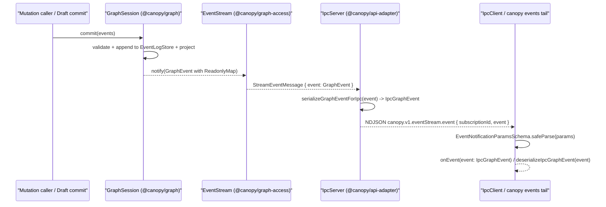

## Context

Status: proposed; design proposal for bead [`canopy-4m9`](https://github.com/mkobit/canopy) ("[bug] Preserve graph property maps at the IPC event serialization boundary").

Related records and authoritative specifications:

- [Core tenets](file:///home/mkobit/workspace/mkobit/canopy/docs/architecture/core-tenets.md)
- [Bounded contexts](file:///home/mkobit/workspace/mkobit/canopy/docs/architecture/bounded-contexts.md)
- [Core data model and type system](file:///home/mkobit/workspace/mkobit/canopy/docs/design/2026-02-06-core-data-model.md)
- [Unix socket IPC transport specification](file:///home/mkobit/workspace/mkobit/canopy/openspec/specs/unix-socket-ipc-transport/spec.md)
- [Graph API access specification](file:///home/mkobit/workspace/mkobit/canopy/openspec/specs/graph-api-access/spec.md)
- [Draft session specification](file:///home/mkobit/workspace/mkobit/canopy/openspec/specs/draft-session/spec.md)
- [IPC server implementation](file:///home/mkobit/workspace/mkobit/canopy/packages/api-adapter/src/ipc/ipc-server.ts)
- [IPC schema definitions](file:///home/mkobit/workspace/mkobit/canopy/packages/api-adapter/src/ipc/ipc-schema.ts)
- [IPC client implementation](file:///home/mkobit/workspace/mkobit/canopy/packages/api-adapter/src/ipc/ipc-client.ts)
- [Kernel Zod schemas](file:///home/mkobit/workspace/mkobit/canopy/packages/graph/src/schemas.ts)

### User-visible outcome and core domain concepts

Users, CLI tools (`canopy events tail`), and local automation agents subscribe to live graph events over the local Unix domain socket IPC server (`canopy.v1.eventStream.subscribe` and `canopy.v1.eventStream.event`).
In Canopy's event-sourced domain model, every state change is recorded as an immutable `GraphEvent` appended to an `EventLogStore` via `GraphSession.commit`.
Four of the eight `GraphEvent` variants carry property maps:

- `NodeCreated` carries `properties: ReadonlyMap<string, PropertyValue>`.
- `NodePropertiesUpdated` carries `changes: ReadonlyMap<string, PropertyValue>`.
- `EdgeCreated` carries `properties: ReadonlyMap<string, PropertyValue>`.
- `EdgePropertiesUpdated` carries `changes: ReadonlyMap<string, PropertyValue>`.

Each `PropertyValue` is a scalar (`string`, `number`, `boolean`, `null`, or `ExternalReference` `{ graph, target }`) or a readonly array of those scalars.
Today, `createIpcServer` passes the in-memory `GraphEvent` directly to `JSON.stringify` when constructing the `canopy.v1.eventStream.event` JSON-RPC 2.0 notification.
Because `JSON.stringify(new Map([['title', 'Hello']]))` produces `"{}"`, every outgoing IPC event notification strips all node and edge properties and property changes.
With this design, IPC event notifications serialize `ReadonlyMap<string, PropertyValue>` into plain JSON objects (`Readonly<Record<string, PropertyValue>>`), preserving all property keys and values on the wire, in `canopy events tail` output, and across round-trip decoding back into domain `GraphEvent` values.

### Architectural boundary placement

This behavior belongs strictly to the `@canopy/api-adapter` protocol adapter layer:

- **Core semantics (`@canopy/graph`)**: retains `ReadonlyMap<string, PropertyValue>` and branded domain identifiers (`NodeId`, `EdgeId`, `TypeId`, `EventId`, `BatchId`, `MigrationId`, `NamespaceId`, `Instant`, `WorkflowDefinitionId`, `WorkflowRunId`) as the canonical in-memory domain representation.
- **Storage adapters (`@canopy/storage-sqlite`, `@canopy/storage-file`)**: already convert `ReadonlyMap` to plain objects via `Object.fromEntries` when writing JSON to disk and parse back via `GraphEventSchema` (whose `PropertyMapSchema` accepts both `Map` and `Record<string, PropertyValue>`).
- **Connect transport adapter (`@canopy/api-adapter/src/connect`)**: already converts `ReadonlyMap` via `Object.fromEntries` in `serializeEventPayload`.
- **Unix socket IPC adapter (`@canopy/api-adapter/src/ipc`)**: owns the JSON-RPC 2.0 wire representation (`IpcGraphEvent`), outbound conversion (`serializeGraphEventForIpc`), inbound notification validation (`EventNotificationParamsSchema`), and domain round-trip decoding (`deserializeIpcGraphEvent`).

### Write/read paths, time travel, concurrency, and capability boundaries



1. **Event write and read paths**: mutations enter through `GraphSession.commit` (or `DraftSession` followed by `draft.commit`), which validates events, appends them to `EventLogStore`, updates the projection, and notifies subscribers with the canonical `GraphEvent`. `IpcServer` receives `StreamEventMessage` from `@canopy/graph-access` and translates the domain `GraphEvent` into an `IpcGraphEvent` at the Unix socket boundary.
2. **Time travel and replay**: historical reconstruction (`@canopy/graph/history.ts`) replays events from `EventLogStore`. Because `IpcGraphEvent` uses the exact JSON-object representation accepted by `GraphEventSchema` and `DraftApplyParamsSchema`, an `IpcGraphEvent` captured from the IPC stream can be parsed back via `GraphEventSchema.safeParse` into an identical domain `GraphEvent` with full `eventId`, `timestamp`, `deviceId`, `batchId`, `migrationId`, and property maps intact.
3. **Concurrency and fan-out**: multiple IPC clients can subscribe concurrently with independent filters (`eventTypes`, `namespace`). `IpcServer` serializes each `GraphEvent` on its subscription path and enforces per-client backpressure (`MAX_QUEUED_EVENTS = 1000`, `SLOW_CONSUMER_TIMEOUT_MS = 5000`).
4. **Capability boundaries**: `@canopy/graph-access` enforces `read:nodes` capability checks before opening the event stream subscription (`subscribeEvents`). The IPC wire codec performs pure data representation translation and never alters or bypasses capability checks.

### Concrete example

Suppose a caller creates a node with `id: "node-1"`, `nodeType: "type:note"`, and `properties: new Map([["title", "Canopy IPC"], ["tags", ["ipc", "jsonrpc"]]])`.

1. `GraphSession.commit` emits a `NodeCreated` domain event whose `properties` field is a `ReadonlyMap` with two entries.
2. `serializeGraphEventForIpc` converts the event into:
   ```json
   {
     "type": "NodeCreated",
     "eventId": "evt-1",
     "id": "node-1",
     "nodeType": "type:note",
     "properties": {
       "title": "Canopy IPC",
       "tags": ["ipc", "jsonrpc"]
     },
     "timestamp": "2026-11-04T00:00:00.000Z",
     "deviceId": "dev-1"
   }
   ```
3. `IpcClient` validates the incoming notification against `EventNotificationParamsSchema` and invokes `onEvent(event)` where `event` is narrowed by `event.type === 'NodeCreated'` and `event.properties` is typed as `Readonly<Record<string, PropertyValue>>`.
4. If the client calls `deserializeIpcGraphEvent(event)`, `GraphEventSchema` parses and transforms `event.properties` back into a `ReadonlyMap<string, PropertyValue>` with `"title"` and `"tags"` preserved.

## Goals and non-goals

### Goals

- Preserve all entries of `NodeCreated.properties`, `EdgeCreated.properties`, `NodePropertiesUpdated.changes`, and `EdgePropertiesUpdated.changes` across `canopy.v1.eventStream.event` notifications.
- Provide a strongly typed, pure-JSON `IpcGraphEvent` discriminated union and `IpcGraphEventSchema` in `@canopy/api-adapter` so TypeScript callers and OpenRPC schema consumers get exact per-variant field types without `Map` union branches.
- Guarantee lossless round-trip compatibility: `deserializeIpcGraphEvent(serializeGraphEventForIpc(domainEvent))` returns `ok(domainEvent)` with deep-equal domain fields and `ReadonlyMap` contents.
- Maintain full backward and forward wire compatibility under `tools/check-api-compatibility.ts` (`check:api-compatibility`) and update `packages/api-adapter/schema-baselines/ipc-openrpc.json`.

### Non-goals

- Changing `@canopy/graph` domain event types (`GraphEvent` in `@canopy/graph` continues to use `ReadonlyMap<string, PropertyValue>` and branded IDs).
- Changing the `EventLogStore` persistence format in `@canopy/storage-sqlite` or `@canopy/storage-file`.
- Modifying Connect, GraphQL, or WASM WIT schemas.
- Staging implementation tasks (`tasks.md`) or claiming implementation beads before this design passes adversarial review and merges.

## Decisions

### 1. Define explicit wire-level `IpcGraphEventSchema` and `IpcGraphEvent` in `@canopy/api-adapter`

In `@canopy/graph`, `PropertyMapSchema` is a `z.union([z.map(...), z.record(...).transform(...)])`.
Using `z.input<typeof GraphEventSchema>` directly as the IPC wire type has two drawbacks:

1. Its TypeScript type for `properties` and `changes` is `Map<string, PropertyValue> | Record<string, PropertyValue>`, forcing IPC client consumers to narrow away `Map` even though JSON over a Unix socket can never produce a `Map`.
2. When `z.toJSONSchema(schema, { io: 'input', unrepresentable: 'any' })` generates the OpenRPC specification, the `z.map` union branch degrades to an empty `{}` schema inside `"anyOf": [{}, { ... }]`.

Therefore, `@canopy/api-adapter` defines a dedicated wire-level `IpcPropertyMapSchema = z.record(z.string(), PropertyValueSchema)` and a discriminated union `IpcGraphEventSchema = z.discriminatedUnion('type', [...])` over the eight event variants (`IpcNodeCreatedEventSchema`, `IpcNodePropertiesUpdatedEventSchema`, `IpcNodeDeletedEventSchema`, `IpcEdgeCreatedEventSchema`, `IpcEdgePropertiesUpdatedEventSchema`, `IpcEdgeDeletedEventSchema`, `IpcWorkflowStartedEventSchema`, `IpcWorkflowCompletedEventSchema`), each with `.passthrough()` for forward compatibility.

- Each variant mirrors the exact fields defined in `@canopy/graph/src/events.ts` and `@canopy/graph/src/schemas.ts`:
  - `NodeCreated`: `{ type: 'NodeCreated', eventId, id, nodeType, properties, timestamp, deviceId, batchId?, migrationId? }`
  - `NodePropertiesUpdated`: `{ type: 'NodePropertiesUpdated', eventId, id, changes, timestamp, deviceId, batchId?, migrationId? }`
  - `NodeDeleted`: `{ type: 'NodeDeleted', eventId, id, timestamp, deviceId, batchId?, migrationId? }`
  - `EdgeCreated`: `{ type: 'EdgeCreated', eventId, id, edgeType, source, target, properties, timestamp, deviceId, batchId?, migrationId? }`
  - `EdgePropertiesUpdated`: `{ type: 'EdgePropertiesUpdated', eventId, id, changes, timestamp, deviceId, batchId?, migrationId? }`
  - `EdgeDeleted`: `{ type: 'EdgeDeleted', eventId, id, timestamp, deviceId, batchId?, migrationId? }`
  - `WorkflowStarted`: `{ type: 'WorkflowStarted', eventId, workflowId, triggerId, timestamp, deviceId, batchId? }`
  - `WorkflowCompleted`: `{ type: 'WorkflowCompleted', eventId, executionId, timestamp, deviceId, batchId? }`
- Identifier fields (`eventId`, `id`, `nodeType`, `edgeType`, `source`, `target`, `workflowId`, `triggerId`, `executionId`, `deviceId`) use `z.string().min(1)` on the wire schema (with `timestamp: z.string().datetime({ offset: true })` and `properties`/`changes: IpcPropertyMapSchema`) without in-memory `Map` or brand transforms, so both UUID event IDs and synthetic test event IDs (such as `asEventId('evt-1')`) validate cleanly on the wire while canonical UUID events round-trip through `GraphEventSchema`.
- `export type IpcGraphEvent = z.infer<typeof IpcGraphEventSchema>` (with `readonly` properties enforced across all variants and nested records) gives consumers a clean discriminated union on `event.type`.
- `EventNotificationParamsSchema` is updated to:
  ```ts
  export const EventNotificationParamsSchema = z
    .object({
      subscriptionId: z.string(),
      event: IpcGraphEventSchema,
    })
    .passthrough();
  ```

### 2. Transport-owned codec: `serializeGraphEventForIpc` and `deserializeIpcGraphEvent`

`@canopy/api-adapter` exports two pure functions from `packages/api-adapter/src/ipc/ipc-schema.ts` (and re-exports them through `packages/api-adapter/src/ipc/index.ts` and `packages/api-adapter/src/index.ts`):

- `serializeGraphEventForIpc(event: GraphEvent): IpcGraphEvent`: switches exhaustively on `event.type`. For `NodeCreated` and `EdgeCreated`, it converts `event.properties` from `ReadonlyMap<string, PropertyValue>` into a plain prototype-safe record via a helper that copies entries into a plain object (`Object.defineProperty` per entry, matching `Object.fromEntries` own-property semantics). For `NodePropertiesUpdated` and `EdgePropertiesUpdated`, it converts `event.changes` similarly. Optional fields (`batchId`, `migrationId`) are omitted when `undefined` so the wire JSON stays compact and schema-valid.
- `deserializeIpcGraphEvent(event: unknown): Result<GraphEvent, IpcProtocolError>`: validates and transforms a wire event back into the canonical domain `GraphEvent` using `GraphEventSchema.safeParse(event)`, returning `ok(parsed.data)` or `err({ code: JSON_RPC_ERROR_CODES.INVALID_PARAMS, message: ... })`.

### 3. Validate incoming event notifications and narrow `IpcClient.subscribe` to `IpcGraphEvent`

In `packages/api-adapter/src/ipc/ipc-client.ts`:

1. `processLines` validates incoming `canopy.v1.eventStream.event` notifications using `EventNotificationParamsSchema.safeParse(response.params)` before invoking the subscriber callback (`if (parsed.success) { subscriptionCallbacks.current.get(parsed.data.subscriptionId)?.(parsed.data.event); }`).
2. `IpcClient.subscribe` updates its parameter type from:

```ts
readonly subscribe: (
  params: SubscribeParams,
  onEvent?: (event: unknown) => unknown,
) => Promise<Result<SubscribeResult, IpcClientError>>;
```

to:

```ts
readonly subscribe: (
  params: SubscribeParams,
  onEvent?: (event: IpcGraphEvent) => unknown,
) => Promise<Result<SubscribeResult, IpcClientError>>;
```

Because any function accepting `(event: unknown) => unknown` is contravariantly assignable to `(event: IpcGraphEvent) => unknown` in TypeScript, existing callers passing `(event: unknown) => ...` or `(event) => ...` (such as `apps/cli/src/commands/events.ts` and existing tests) remain 100% source-compatible while gaining strong discriminated-union inference when `event` is unannotated.

### 4. OpenRPC baseline and API compatibility laws

In `tools/lib/api-compatibility-checker.ts`, `checkIpc` enforces that:

- No existing IPC method is removed.
- No required parameter is added to an existing method.
- No existing parameter is removed.
- No existing result property or error code is removed.

Updating `EventNotificationParamsSchema.shape.event` from `z.record(z.string(), z.unknown())` to `IpcGraphEventSchema` preserves the method name (`canopy.v1.eventStream.event`), parameter names (`subscriptionId`, `event`), and `required` flags (`true`, `true`).
Regenerating `packages/api-adapter/schema-baselines/ipc-openrpc.json` via `bun tools/check-api-compatibility.ts --target=ipc --update-baselines` updates the baseline snapshot to document all eight `IpcGraphEvent` variants and passes both `check:api-compatibility` and `packages/api-adapter/tests/schema-baselines.test.ts` without requiring any breaking-change waiver.

## Adversarial review and mitigations

### Category A: Resource and performance overhead

#### Risk A1: Repeated map-to-object allocation during multi-subscriber fan-out

- **Threat & mechanism**:
  When a high-throughput batch commit emits hundreds of events and `N` clients are subscribed to the IPC server, converting `ReadonlyMap<string, PropertyValue>` into a plain object repeatedly or cloning large property arrays unnecessarily increases heap churn and GC pressure on the daemon event loop.
- **Consequence**:
  Elevated latency on `canopy.v1.eventStream.event` dispatch and increased memory allocation under concurrent subscriptions.
- **Actionable mitigation**:
  1. Keep `serializeGraphEventForIpc` O(K) in the number of top-level properties `K` for the four map-carrying event variants, and O(1) shallow object construction for the four map-free variants (`NodeDeleted`, `EdgeDeleted`, `WorkflowStarted`, `WorkflowCompleted`).
  2. Reuse the already-immutable `PropertyValue` scalar and readonly array references without deep-cloning nested arrays.
  3. Enforce the existing `MAX_LINE_BYTES` (10 MiB) NDJSON framing guard and `@canopy/graph`'s 1 MiB per-property size bound (`MAX_PROPERTY_SIZE_BYTES`) so no single serialized event can exhaust daemon memory.
- **Verifiable acceptance criteria**:
  - `serializeGraphEventForIpc` allocates only the top-level event wrapper and single shallow property record for map-carrying variants.
  - Existing slow-consumer backpressure tests (`MAX_QUEUED_EVENTS = 1000`) continue to pass with serialized `IpcGraphEvent` payloads.

### Category B: Failure modes and edge cases

#### Risk B1: Optional fields serialized as explicit `undefined` keys or failing strict schema validation

- **Threat & mechanism**:
  `GraphEvent` variants carry optional fields (`batchId`, `migrationId`). Under `exactOptionalPropertyTypes` or Zod object validation, setting `{ batchId: undefined }` on an in-memory object before `IpcGraphEventSchema.safeParse` can behave differently from omitting the key after `JSON.parse(JSON.stringify(...))`.
- **Consequence**:
  In-memory validation of `serializeGraphEventForIpc(event)` against `IpcGraphEventSchema` could fail when optional fields are absent, or produce inconsistent keys compared to JSON round-trip.
- **Actionable mitigation**:
  1. Conditionally spread optional fields in `serializeGraphEventForIpc` (e.g., `...(event.batchId !== undefined ? { batchId: event.batchId } : {})`) so absent optional fields are never present with value `undefined`.
  2. Test both in-memory `IpcGraphEventSchema.safeParse(serializeGraphEventForIpc(event))` and wire-level `JSON.parse(JSON.stringify(serializeGraphEventForIpc(event)))` across all eight `GraphEvent` variants with optional fields both present and omitted.
- **Verifiable acceptance criteria**:
  - `Object.keys(serializeGraphEventForIpc(event))` contains no keys with `undefined` values for any `GraphEvent` variant.
  - All eight `GraphEvent` variants pass both `IpcGraphEventSchema.safeParse` and `deserializeIpcGraphEvent` with and without optional fields.

#### Risk B2: Complex `PropertyValue` shapes (`null`, `ExternalReference`, homogeneous and mixed scalar arrays, empty maps)

- **Threat & mechanism**:
  A `PropertyValue` can be `null`, a boolean `false`, number `0`, empty string `""`, an `ExternalReference` (`{ graph: UUID, target: string }`), or a readonly array of those values, and a property map can be empty (`new Map()`). Naive falsy checks or incomplete schema definitions could drop falsy values or reject `ExternalReference` items.
- **Consequence**:
  Silent corruption of `null`/`false`/`0`/`""` properties or schema validation failure on cross-graph `ExternalReference` properties when `IpcClient` parses incoming notifications.
- **Actionable mitigation**:
  1. Reuse `@canopy/graph`'s canonical `PropertyValueSchema` directly in `IpcPropertyMapSchema = z.record(z.string(), PropertyValueSchema)` so `IpcGraphEventSchema` and `GraphEventSchema` share the exact same `PropertyValue` validator.
  2. Convert maps without filtering entries by value truthiness.
- **Verifiable acceptance criteria**:
  - Unit and integration tests verify lossless round-trip over a live Unix domain socket for empty maps, `string`, `number` (`0`, negative, float), `boolean` (`false`, `true`), `null`, `ExternalReference`, and arrays containing scalars and `ExternalReference` objects.

#### Risk B3: Malformed or unrecognized event notification on client receive path

- **Threat & mechanism**:
  If a server or corrupted stream emits an invalid `canopy.v1.eventStream.event` payload, `IpcClient` parses incoming notifications using `EventNotificationParamsSchema.safeParse`.
- **Consequence**:
  If `EventNotificationParamsSchema` rejects a valid event variant (e.g., `WorkflowStarted` or `EdgePropertiesUpdated`), `IpcClient` silently drops the notification and never invokes `onEvent`.
- **Actionable mitigation**:
  1. Include all eight `GraphEvent` variants in `IpcGraphEventSchema`.
  2. Attach `.passthrough()` to every variant object schema in `IpcGraphEventSchema` so additive future fields on an existing variant do not break older clients.
- **Verifiable acceptance criteria**:
  - Every `GraphEvent` variant in `@canopy/graph` is covered by `IpcGraphEventSchema` and verified in automated round-trip tests.
  - Extra unknown properties on a wire event variant are preserved by `.passthrough()` without failing `EventNotificationParamsSchema.safeParse`.

### Category C: Security and isolation

#### Risk C1: Prototype pollution via `__proto__` property keys in graph property maps

- **Threat & mechanism**:
  A `ReadonlyMap<string, PropertyValue>` can legitimately hold the key `"__proto__"`, `"constructor"`, or `"prototype"`. Constructing a plain object via naive property assignment `obj[key] = value` mutates the object prototype or drops the `"__proto__"` own property, and `Object.fromEntries` / `JSON.parse` interactions must preserve own enumerable properties without polluting `Object.prototype`.
- **Consequence**:
  Dropped `"__proto__"` property key or prototype mutation during serialization/deserialization.
- **Actionable mitigation**:
  1. Construct serialized property records using `Object.defineProperty` (matching `Object.fromEntries` specification semantics, which defines own enumerable data properties even for `"__proto__"`) and validate via `z.record(z.string(), PropertyValueSchema)`.
  2. When decoding back into a domain `GraphEvent`, `GraphEventSchema` uses `new Map(Object.entries(record))`, which reads only own enumerable string keys and stores them safely inside a `Map`.
- **Verifiable acceptance criteria**:
  - A `NodeCreated` event with a property key `"__proto__"` or `"constructor"` serializes to JSON and deserializes back into a `ReadonlyMap` containing that exact key without modifying `Object.prototype`.

### Category D: Migration and backward compatibility

#### Risk D1: Breaking existing IPC client callbacks or CLI output format

- **Threat & mechanism**:
  Existing callers of `IpcClient.subscribe` (including `apps/cli/src/commands/events.ts` and `packages/api-adapter/tests/ipc-server.test.ts`) pass callbacks expecting a JSON-serializable object with `event.type` and event fields. Previously `event.properties` was `{}` on the wire due to the bug; fixing it populates `event.properties` and `event.changes` with the actual property keys and values.
- **Consequence**:
  If the wire codec changed `properties` into an array of tuples `[[k, v]]` instead of a plain JSON object `{ [k]: v }`, existing JSON consumers, `DraftApplyParamsSchema`, and `GraphEventSchema` would break.
- **Actionable mitigation**:
  1. Serialize `ReadonlyMap<string, PropertyValue>` as a plain JSON object (`Readonly<Record<string, PropertyValue>>`), which matches the existing `{}` wire type (`object`), the Connect adapter (`serializeEventPayload`), the storage adapters (`sqlite-event-log.ts`, `file-event-log.ts`), and `GraphEventSchema`'s record input branch.
  2. Keep `IpcClient.subscribe`'s `onEvent` parameter contravariantly compatible with `(event: unknown) => unknown`.
- **Verifiable acceptance criteria**:
  - `canopy events tail` (`apps/cli/src/commands/events.ts`) prints valid single-line JSON events containing populated `properties` and `changes` objects without any code change required in `apps/cli`.
  - `bun tools/check-api-compatibility.ts` passes with zero breaking changes.
