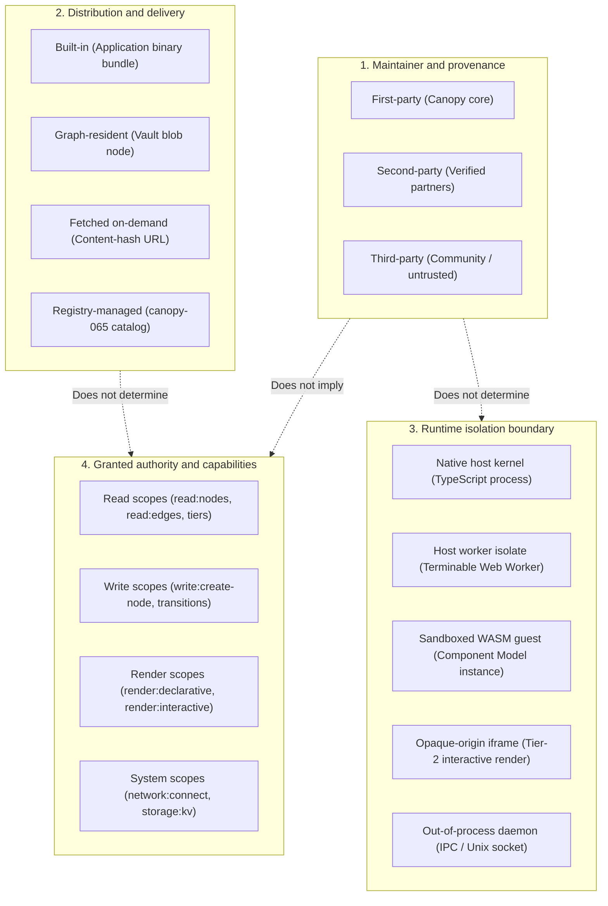

## Context

Status: proposed; design proposal for bead [`canopy-ax6`](https://github.com/mkobit/canopy) ("Define primitive, system plugin, and extension boundaries").

Related records and approved designs:
- [Core tenets](file:///home/mkobit/workspace/mkobit/canopy/docs/architecture/core-tenets.md)
- [Bounded contexts](file:///home/mkobit/workspace/mkobit/canopy/docs/architecture/bounded-contexts.md)
- [Core data model and type system](file:///home/mkobit/workspace/mkobit/canopy/docs/design/2026-02-06-core-data-model.md)
- [Extension and execution model](file:///home/mkobit/workspace/mkobit/canopy/docs/design/2026-02-08-extension-and-execution-model.md)
- Bead `canopy-usd` (durable triggered workflows)
- Bead `canopy-fi4` (agent memories and fleeting notes)
- Bead `canopy-9zu` (first-party aged-node plugin)
- Bead `canopy-k35` (MCP access across graph and memory capabilities)
- Bead `canopy-dfb` (pluggable authentication and authorization)
- Bead `canopy-o5q` (remote operation with user-owned data)

Software systems often confuse origin, packaging, runtime isolation, and permissions.
Canopy strictly separates these four orthogonal dimensions.
This design defines the system tiers and boundary rules across primitives, host services, first-party plugins, and third-party extensions.

## Goals and non-goals

### Goals

- Define four independent dimensions of extensibility: maintainer provenance, distribution, runtime isolation, and granted authority.
- Classify all components into four distinct tiers (Tier 0 Kernel, Tier 1 Host services, Tier 2 First-party extensions, Tier 3 Third-party extensions).
- Ensure `@canopy/graph` remains an irreducible, internal-dependency-free leaf package.
- Ensure first-party maintainer status does not convey ambient authority or unmetered host execution.
- Maintain graph schema durability so node and edge types persist when plugins are disabled or removed.
- Provide a resilient view resolution fallback cascade to prevent application crashes on missing or failing renderers.
- Require explicit literal strings for sensitive capabilities (no wildcard expansion).

### Non-goals

- Implementing the plugin marketplace registry (owned by `canopy-065`).
- Implementing the remote server synchronizer or cloud relay (owned by `canopy-o5q`).
- Replacing the WebAssembly Component Model runtime or changing existing WIT bindings.
- Modifying the underlying event log serialization or storage format.
- Staging implementation tasks before adversarial mitigations receive maintainer approval.

## Decisions

### 1. De-conflating the four dimensions of extensibility

Canopy evaluates every software component across four independent dimensions:



Rules of orthogonality:
1. Maintainer origin does not grant runtime privilege. First-party domain plugins run in WebAssembly sandboxes.
2. Distribution does not grant authority. Bundled plugins require explicit capability tokens.
3. Execution location does not bypass authorization. Host calls require capability verification.
4. Capabilities require explicit grants. Wildcards do not grant sensitive permissions.

### 2. Four-tier system classification

Canopy categorizes all software components into four system architecture tiers (distinct from UI render isolation tiers):

```
┌────────────────────────────────────────────────────────────────────────┐
│          System Tier 3: Ecosystem & Third-Party Extensions             │
│    (Custom visualizers, community workflows, external SaaS sync)       │
│    Isolation: Sandboxed WASM / Opaque iframe  |  Capability: Scoped    │
├────────────────────────────────────────────────────────────────────────┤
│          System Tier 2: Canopy-Maintained Extensions (1P)              │
│    (Markdown renderer, Kanban view, Node aging, Fleeting note memory)  │
│    Isolation: Sandboxed WASM / Worker isolate |  Capability: Explicit  │
├────────────────────────────────────────────────────────────────────────┤
│          System Tier 1: System Host Services                           │
│    (Plugin host, Query engine, Settings cascade, Storage, API adapters)│
│    Isolation: Native host process             |  Capability: Broker    │
├────────────────────────────────────────────────────────────────────────┤
│          System Tier 0: Graph Kernel Primitives                        │
│    (EventLogStore, GraphSession, Type-aware projection, Schemas)       │
│    Isolation: Pure TypeScript leaf            |  Capability: Invariant │
└────────────────────────────────────────────────────────────────────────┘
```

Note: UI render isolation uses Render Tier 1 (sanitized inline shadow DOM) and Render Tier 2 (sandboxed opaque iframe).
System Tier 2 and Tier 3 extensions share identical sandbox isolation and capability checks.
Their distinction is repository governance and maintenance provenance.

- **System Tier 0: Graph kernel primitives (`@canopy/graph`)**:
  Contains the irreducible mathematical foundation of Canopy: branded IDs, core graph entities, schemas, `EventLogStore` port, and `GraphSession` projection.
  It has no UI, no network, and no WebAssembly dependencies.
- **System Tier 1: System host services**:
  Provides platform infrastructure in native host execution: `@canopy/plugin-host` (WASM compilation, instantiation, metering), `@canopy/graph-access` (protocol-neutral operations), `@canopy/queries` (traversal pipelines), `@canopy/settings` (configuration cascade), storage packages (`@canopy/storage*`), and protocol servers (`@canopy/api-adapter`).
- **System Tier 2: First-party extensions**:
  Standard domain plugins maintained in the core repository (markdown renderer, kanban view, node aging automations, memory consolidation).
  These plugins execute inside sandboxed WebAssembly guests or terminable worker isolates.
- **System Tier 3: Third-party ecosystem extensions**:
  Community and external extensions running under strict capability-based isolation with zero ambient privilege.

### 3. Concrete domain boundary placement

| Domain case | Kernel primitive (Tier 0) | System host service (Tier 1) | Extension plugin (Tier 2 / 3) |
| :--- | :--- | :--- | :--- |
| **Durable workflows** (`canopy-usd`) | Workflow event schemas (`WorkflowStarted`, `WorkflowStepExecuted`) | Host daemon workflow coordinator, retry timers, state recovery | Action step guest plugins, authoring wizard UI |
| **Agent memories** (`canopy-fi4`) | Node lifecycle state (`provisional`, `canonical`), provenance fields | Read-tier query filtering (Tier 1 Canonical vs Tier 2 Memory) | Consolidation heuristics, embedding generators, forgetting rules |
| **Node aging** (`canopy-9zu`) | Temporal metadata properties (`created`, `modified`), timestamp indices | Periodic tick emitter, scheduler in daemon host | Aged-node evaluation plugin, review queue view |
| **Task tracking & Kanban** | `Task` node type definition, `depends_on` edge type definition | Graph query pipeline filtering tasks and resolving dependencies | Kanban board view definition, drag-and-drop interactive renderer |
| **Content renderers** | `RendererDefinition` node schema, `ViewDefinition` node schema | Render dispatcher, shadow DOM sanitizer, iframe manager | Markdown renderer, interactive canvas visualizer |
| **MCP & gateway** (`canopy-k35`) | Standard domain commands, read tiers | `canopy:external-gateway` protocol broker | Protocol adapter guest plugins (MCP 1.0, JSON-RPC, REST) |
| **Auth & identity** (`canopy-dfb`) | Principal attribution on events (`DeviceId`, actor id), tokens | Capability verification interceptor | Identity provider connectors (OIDC, SAML, WebAuthn) |

### 4. Durable schema retention and type lifecycle

1. When a plugin registering custom node or edge types is uninstalled or disabled, its `NodeTypeDefinition` and `EdgeTypeDefinition` records remain in the graph.
2. The host marks uninstalled plugin types as `inactive` (via a `status: 'inactive'` property on definition nodes), preserving schema structure.
3. The query engine continues to query and retrieve existing nodes and edges of inactive types.
4. Attempting to create new nodes of an `inactive` type via `createNode` fails with a `TYPE_INACTIVE` validation error.
5. Deleting existing nodes (`NodeDeleted` tombstoning) of an inactive type remains permitted.
6. Historical event replay succeeds without errors because the schema definitions remain intact.
7. Deleting a type definition requires an explicit user-confirmed schema deprecation transaction, not a side effect of binary removal.

### 5. View resolution fallback cascade

When resolving a view for a node:
1. The host searches for the active `Renderer` (historically called `RendererDefinition`) specified by the view.
2. If the renderer is missing or inactive, the host falls back to the registered format fallback (e.g. Markdown falls back to plain text). Exception: If an interactive renderer authorized for Render Tier 2 lacks a valid worker guest, the host displays a host-owned unavailable indicator and does not execute an alternate guest or downgrade to Render Tier 1.
3. If no compatible renderer exists, the host falls back to the built-in generic property table inspector.
4. If a guest renderer throws an error or times out, the host captures the error in a structured error boundary banner with an affordance to view raw node properties.
5. The host never enters an unhandled error state or empty screen due to renderer failures.

### 6. Explicit capability grants for sensitive scopes

1. The capability verification system requires exact literal matches for sensitive permissions.
2. Sensitive scopes include `render:interactive`, proposed `network:connect`, and write operations (`write:create-node`, `write:update-properties`, `write:delete-node`, `write:create-edge`, `write:delete-edge`).
3. Wildcard tokens (such as `*`, `render:*`, or `write:*`) do not grant sensitive scopes.
4. Capability tokens are verified cryptographically or session-bound by host services during every guest invocation.

## Adversarial review and mitigations

### Category A: Resource and performance overhead

#### Risk A1: Storage bloat from WebAssembly binaries in graph properties
- **Threat & mechanism**:
  An extension node stores a large compiled WebAssembly binary (e.g. 25 MiB) as a string property in the event log.
  Synchronizing devices download the binary repeatedly across property updates, exhausting storage and memory.
- **Consequence**:
  Disk exhaustion and slow graph initial projection.
- **Actionable mitigation**:
  1. Enforce a maximum property size of 1 MiB on standard graph node properties.
  2. Store WebAssembly binaries in content-addressable storage out-of-band.
  3. Store only the content hash (`sha256:...`) and byte size as node properties on `Extension` nodes.
- **Verifiable acceptance criteria**:
  - `validateProperty` rejects property payloads exceeding 1 MiB with `VALIDATION_ERROR`.
  - Extension node events transfer fewer than 2 KiB of metadata in the event log.

#### Risk A2: CPU starvation from guest compute loops
- **Threat & mechanism**:
  A buggy or malicious view renderer runs an infinite loop or exponential computation during rendering.
- **Consequence**:
  The application UI freezes and becomes unresponsive.
- **Actionable mitigation**:
  1. Execute untrusted guest code in a Web Worker isolate using `executeTerminableGuest`.
  2. Enforce a 2000 ms wall-clock deadline using host-managed timers.
  3. Terminate the worker isolate forcefully if the guest does not return within the deadline.
  4. Render an error boundary banner in place of the timed-out component.
- **Verifiable acceptance criteria**:
  - Runaway guest execution terminates at 2000 ms (+/- 50 ms).
  - Main thread remains responsive and frame rate stays above 55 FPS.
  - The UI displays a `RESOURCE_EXHAUSTED` error banner.

#### Risk A3: Index contention from synchronous event hooks
- **Threat & mechanism**:
  A plugin registers a synchronous pre-commit hook on node creation.
  During bulk import of 10,000 nodes, the hook executes synchronously for each node, performing traversals before committing.
- **Consequence**:
  Import throughput drops severely; the commit lock blocks interactive user edits.
- **Actionable mitigation**:
  1. Restrict synchronous pre-commit hooks strictly to pure schema validation.
  2. Execute plugin automations and workflow triggers asynchronously over the transient event bus or post-commit event stream.
  3. Decouple event log appending from plugin notification queues.
- **Verifiable acceptance criteria**:
  - `GraphSession.commit` returns within 5 ms regardless of registered background plugins.
  - Bulk ingestion of 10,000 nodes completes in under 2 seconds.

### Category B: Failure modes and edge cases

#### Risk B1: Dangling node types after plugin removal
- **Threat & mechanism**:
  A user installs a plugin defining a custom node type, creates hundreds of nodes, and uninstalls the plugin.
  Subsequent queries fail with unknown type errors.
- **Consequence**:
  User data becomes inaccessible; the vault enters an unrecoverable state.
- **Actionable mitigation**:
  1. Invariant: `NodeTypeDefinition` records are durable graph entities that persist independently of plugin binary state.
  2. The host marks uninstalled plugin types as `inactive`, preserving schema definitions.
  3. The query engine continues to query inactive types normally.
  4. View resolution cascades to the generic property inspector.
- **Verifiable acceptance criteria**:
  - Querying nodes of an uninstalled plugin type returns all nodes with complete properties.
  - The UI renders node properties using the fallback property table without console errors.

#### Risk B2: Schema and namespace collisions across plugins
- **Threat & mechanism**:
  Two independent plugins define a node type named `Task` with conflicting property types.
- **Consequence**:
  Validation failures and corrupted node properties.
- **Actionable mitigation**:
  1. Enforce namespace prefixing based on plugin identifiers (e.g. `com.example.tasks:Task`).
  2. Reserve the `canopy:*` namespace exclusively for core system types.
  3. Reject type authoring events that conflict with existing registered type IDs.
- **Verifiable acceptance criteria**:
  - A third-party plugin attempting to register in `canopy:*` fails with `FORBIDDEN`.
  - Type collisions return an explicit `ALREADY_EXISTS` error before event commit.

#### Risk B3: Orphan workflow state and dangling execution checkpoints
- **Threat & mechanism**:
  A durable workflow is executing a multi-step process when the user uninstalls the plugin that implements the next step action.
- **Consequence**:
  Resource consumption from failed retries and lost workflow state.
- **Actionable mitigation**:
  1. The workflow coordinator detects missing action handlers and transitions the execution state to `Suspended (Missing Plugin)`.
  2. The coordinator suspends retry timers and records a `WorkflowSuspended` audit event.
  3. The UI notifies the user to re-enable the plugin or cancel the workflow.
- **Verifiable acceptance criteria**:
  - Missing action handler suspends workflow after one failed lookup without retry loops.
  - Re-enabling the plugin enables resumption from the saved checkpoint.

#### Risk B4: Guest memory panic crashing host process
- **Threat & mechanism**:
  A WebAssembly plugin panics with an unhandled `unreachable` opcode or out-of-bounds memory read.
- **Consequence**:
  Host application crashes or browser React tree unmounts.
- **Actionable mitigation**:
  1. Wrap all guest invocations in safe `Result<T, GraphAccessError>` boundary functions.
  2. Convert guest traps into structured error codes (`INTERNAL_ERROR`, `RESOURCE_EXHAUSTED`).
  3. Isolate untrusted execution in Web Workers.
- **Verifiable acceptance criteria**:
  - A WebAssembly guest triggering an `unreachable` opcode returns an `err(GraphAccessError)`.
  - The host process, event loop, and UI remain completely stable.

#### Risk B5: Excessive schema bloat from repeated plugin registrations
- **Threat & mechanism**:
  A rogue or misconfigured plugin repeatedly registers unique `NodeTypeDefinition` nodes during installation loops.
- **Consequence**:
  Unbounded growth of type indices and memory consumption during projection.
- **Actionable mitigation**:
  1. Enforce type registration limits per plugin namespace.
  2. Require explicit user confirmation for registering new type definitions.
- **Verifiable acceptance criteria**:
  - Registering more than 50 types per plugin namespace requires explicit administrator override.

### Category C: Security and isolation

#### Risk C1: Wildcard privilege escalation to sensitive capabilities
- **Threat & mechanism**:
  A plugin granted `render:*` automatically inherits a newly introduced `render:interactive` capability, allowing arbitrary script execution in iframes.
- **Consequence**:
  Privilege escalation from safe static rendering to interactive script execution.
- **Actionable mitigation**:
  1. Enforce the non-wildcard invariant: sensitive capabilities require an explicit, literal string grant.
  2. Capability checks ignore wildcard tokens (`*`, `render:*`) for sensitive capabilities.
- **Verifiable acceptance criteria**:
  - Token with `render:*` returns `false` when checked for `render:interactive`.
  - `resolveRenderTier` resolves to sanitized inline render unless literal `'render:interactive'` is granted.

#### Risk C2: Capability token forgery between guest and host
- **Threat & mechanism**:
  A guest plugin fabricates a high-privilege capability token string in memory before passing it into host query imports.
- **Consequence**:
  Untrusted guest reads or mutates unauthorized graph data.
- **Actionable mitigation**:
  1. The host binds capability tokens into the guest host-binding closure upon instantiation (`boundToken`).
  2. Host bindings verify capabilities strictly against the closure-bound token.
  3. Host bindings reject caller-supplied token overrides across the guest ABI.
- **Verifiable acceptance criteria**:
  - A guest passing a forged capability token string across the ABI cannot execute ungranted operations.
  - Omission of a host-bound token fails closed with `PERMISSION_DENIED`.

#### Risk C3: Worker escape via global scope pollution
- **Threat & mechanism**:
  A guest inside a Web Worker accesses the global scope, creates a nested `new Worker()`, and spawns an unmetered background process.
- **Consequence**:
  Resource theft and execution outside host supervision.
- **Actionable mitigation**:
  1. Sanitize the worker global scope prior to guest instantiation using `hardenGuestWorkerScope`.
  2. Delete `Worker`, `SharedWorker`, `fetch`, `WebSocket`, `XMLHttpRequest`, and `indexedDB` from the global scope.
  3. Freeze the global prototype chain.
- **Verifiable acceptance criteria**:
  - `hardenGuestWorkerScope` removes `Worker`; calling `new Worker()` throws `TypeError`.
  - Guest isolate has zero ambient network or storage APIs.

#### Risk C4: UI clickjacking and overlay attacks via interactive rendering
- **Threat & mechanism**:
  An interactive renderer creates an invisible full-screen overlay to intercept user keystrokes and clicks.
- **Consequence**:
  Credential theft and deceptive UI interactions.
- **Actionable mitigation**:
  1. Mount interactive renderers exclusively in an opaque-origin sandboxed iframe (`sandbox="allow-scripts"` without `allow-same-origin`).
  2. Apply CSS containment and viewport boundary styling (`contain: strict; overflow: hidden`).
  3. Display a persistent visual indicator marking the boundary of third-party interactive frames.
- **Verifiable acceptance criteria**:
  - Iframe script cannot access parent `window.parent` or cookies.
  - Iframe elements cannot render outside the assigned container bounding box.

#### Risk C5: Data exfiltration via unauthorized side channels
- **Threat & mechanism**:
  A plugin with read capability encodes graph data into high-resolution timing patterns or resource requests.
- **Consequence**:
  Unauthorized exfiltration of private knowledge.
- **Actionable mitigation**:
  1. Enforce data minimization: pass only node properties strictly required for rendering that specific node into the iframe.
  2. Enforce zero ambient network access in guest sandbox and iframe environments.
  3. Clamp `performance.now()` timing precision to 10 ms resolution in guest isolates.
  4. Apply strict Content Security Policy (`default-src 'none'; style-src 'unsafe-inline'`).
- **Verifiable acceptance criteria**:
  - Render payload passed to guest contains only the target node content.
  - Loading an external resource `` is blocked by CSP.
  - Zero outgoing network packets detected during guest execution.

#### Risk C6: Transient event bus spoofing and unauthorized eavesdropping
- **Threat & mechanism**:
  A Tier 3 plugin subscribes to or publishes events on the in-memory transient event bus, intercepting sensitive user interactions or injecting fake automation triggers.
- **Consequence**:
  Privilege escalation across plugins and data leakage.
- **Actionable mitigation**:
  1. Namespace transient event topics (e.g. `plugin-id:event-name`).
  2. Require explicit capability grants (`events:subscribe:<topic>`, `events:publish:<topic>`) for inter-plugin events.
- **Verifiable acceptance criteria**:
  - An unauthorized plugin publishing to system event topics returns `PERMISSION_DENIED`.

### Category D: Migration and data ownership risks

#### Risk D1: Proprietary binary formats in property values
- **Threat & mechanism**:
  A plugin serializes complex domain state as an opaque proprietary binary blob in property values.
  When the plugin becomes unmaintained, data becomes undecodable.
- **Consequence**:
  Loss of data ownership and vendor lock-in.
- **Actionable mitigation**:
  1. Enforce strict scalar property types (`string`, `number`, `boolean`, `null`, `ExternalReference`, and lists of scalars).
  2. Reject arbitrary binary buffers or unindexed JSON blobs in canonical property maps.
  3. Model complex domain entities as first-class typed nodes and edges.
- **Verifiable acceptance criteria**:
  - `PropertyValueSchema` rejects raw ArrayBuffers and arbitrary untyped objects.
  - All property values export cleanly to standard JSONL without proprietary decoders.

#### Risk D2: Schema breakage across plugin upgrades
- **Threat & mechanism**:
  A plugin updates and renames a mandatory property without a migration plan, breaking existing nodes.
- **Consequence**:
  Disables existing vaults and blocks event projection.
- **Actionable mitigation**:
  1. Type definitions are append-only; removing or renaming properties requires an explicit migration transaction.
  2. The kernel supports versioned type definitions.
  3. Replaying history validates events against the schema active at the event's recorded instant.
- **Verifiable acceptance criteria**:
  - Updating a `NodeTypeDefinition` preserves backward compatibility for existing events.
  - Replaying history validates events against the recorded schema version.

#### Risk D3: Multi-device offline split-brain execution of automations
- **Threat & mechanism**:
  Two devices running the same vault are offline simultaneously.
  Both trigger an aging transition for the same node, emitting conflicting events.
- **Consequence**:
  Duplicate workflow events and synchronization divergence.
- **Actionable mitigation**:
  1. Implement idempotent state transitions: `NodeStateTransitioned` requires matching `previousState`.
  2. The second event becomes a no-op during convergent log replay because the node is already in the new state.
  3. Attribute events with `deviceId`.
- **Verifiable acceptance criteria**:
  - Concurrent `NodeStateTransitioned` events with identical `newState` converge deterministically without error.
  - Graph state after synchronization is identical on both devices.
